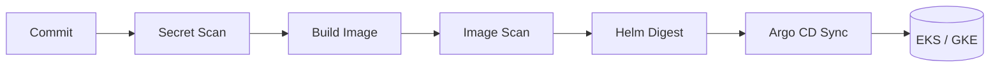

---

### Overview

DevOps Engineer Apprentice at **American Express** with 10 months of hands-on experience running cloud platforms on **AWS** and **GCP**. I work across **EKS/GKE** operations, GitOps delivery, Terraform-based infrastructure, and production support, with a focus on automation that reduces toil and cloud cost.

**10 months** DevOps experience | **2** cloud platforms | **5** idle clusters retired | **Top 5** engineer recognition | **500+** LeetCode problems

### Experience

**DevOps Engineer Apprentice** · American Express
*Jan 2026 - Present*

| Focus | What I deliver |
|---|---|
| **GitOps CI/CD** | GitHub Actions pipeline that builds and security-scans container images, updates Helm image digests, and triggers Argo CD deployments |
| **Infrastructure as Code** | AWS and GCP test and production infrastructure provisioned and managed with Terraform |
| **Kubernetes Operations** | EKS/GKE microservices, cluster upgrades, new-cluster setup, multi-region deployments, and DR exercises |
| **FinOps Automation** | Automation that identified idle clusters, leading to the shutdown of 3 EKS and 2 GKE clusters |
| **Platform Support** | On-call support through InfraBot for application onboarding, troubleshooting, and on-prem → EKS/GKE migrations |
| **Backend Engineering** | Internal application development with Python, FastAPI, and PostgreSQL |
| **Reliability** | Major Incident Management, root-cause analysis, and RFC-driven change management |

### Delivery Pipeline

### Tech Stack

<table>
<tr><td align="center" bgcolor="#0d1117"><b>&#9729; Cloud</b>  
</td>
<td align="center" bgcolor="#0d1117"><b>&#128051; Containers &amp; GitOps</b>  
 
 </td></tr>
<tr><td align="center" bgcolor="#0d1117"><b>&#9881; CI/CD &amp; IaC</b>  
</td>
<td align="center" bgcolor="#0d1117"><b>&#128190; Backend &amp; Data</b>  
</td></tr>
<tr><td align="center" bgcolor="#0d1117"><b>&#128225; Observability</b>  
 
 </td>
<td align="center" bgcolor="#0d1117"><b>&#128736; Workflow</b>  
 
</td></tr>
</table>

AWS: IAM, EC2, VPC, S3, ELB, Auto Scaling &nbsp;|&nbsp; GCP: Compute Engine, IAM, VPC, GCS, Cloud LB, MIGs

### Recognition

- **Top 5 Engineer**: recognized for deployment, application onboarding, and automation tool development
- **GrowthHack, American Express**: semifinalist; built *AI Predictive Resilience* with a five-member team
- **LeetCode**: 500+ problems solved

### Featured Project

**[E-Commerce Store](https://github.com/Vipinmaury/E-Commerce)**: full-stack online shopping platform

**Stack:** React, Redux, Tailwind CSS, Node.js, Express, MongoDB

- Product browsing, cart, and order management
- Redux state management with optimized MongoDB data access
- JWT authentication with role-based access control
- Real-time product updates through state synchronization

### Education

**B.Tech, Information Technology**: Deen Dayal Upadhyaya Gorakhpur University · 2021–2025 · CGPA 7.41/10

---

<i>Infrastructure as Code | GitOps | Automation First</i>

